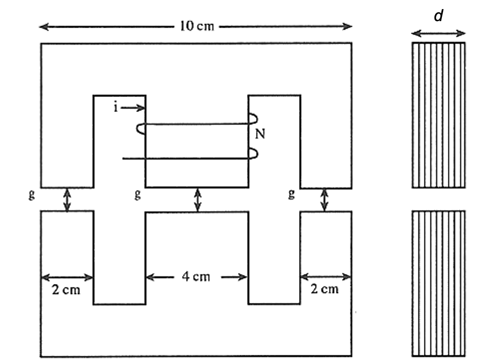
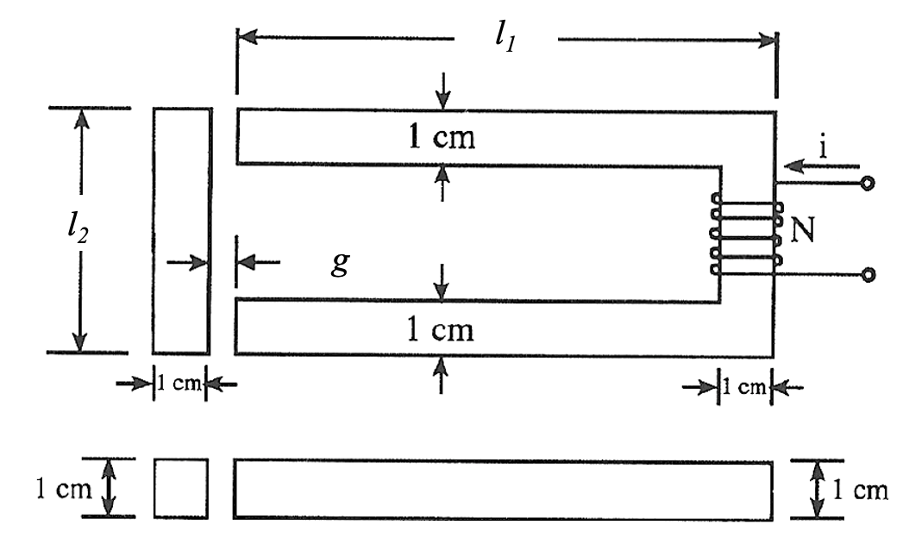
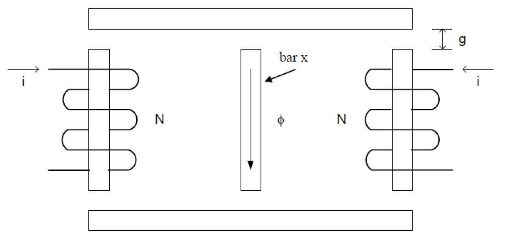

# ECE330 HW3 · 题目来源快照

网页题面转录，采集日期 2026-09-27。共5题；保留当前参数与原图，不含个人答案，不代表提交。原网站无独立作业 PDF，本文件为网页题目归档。

## HW3.1 · 3.10

[当前题目版本](https://us.prairielearn.com/pl/course_instance/226894/instance_question/721260886/?variant_id=171848096)

A 280/140 V, 3 kVA, 60 Hz, single-phase transformer is used to supply power to a 3 kVA resistive load (PF=1.0) at rated voltage of 140 V.

Assuming the transformer is ideal, what would be the magnitude of the current on the primary (280 V) side?

$I_p$ [A] = ______

Assuming the transformer is ideal, what is the apparent impedance of the load viewed from the the primary (280 V) side?

$R_p$ [$\Omega$] = ______

## HW3.2 · SP 4.1

[当前题目版本](https://us.prairielearn.com/pl/course_instance/226894/instance_question/721260888/?variant_id=171848098)

A 390/130 V, 3.1 kVA, 60 Hz, single-phase transformer is used to supply power to a 3.1 kVA load with PF=0.8 lagging at rated voltage of 130 V.

Assuming the transformer is ideal, what would be the magnitude of the current on the primary (390 V) side?

$I_p$ [A] = ______

Assuming the transformer is ideal, what is the apparent impedance of the load viewed from the the primary (390 V) side?

$R_p$ [$\Omega$] = ______

$X_p$ [$\Omega$] = ______

## HW3.3 · 3.3

[当前题目版本](https://us.prairielearn.com/pl/course_instance/226894/instance_question/721260885/?variant_id=171848100)

Consider the following iron core, illustrated with a frontal view on the left and a side view on the right:

Let $i=4.6$ A, $N=218$ turns, $d=3.7$ cm, and $g=0.33$ cm. Assume that the permeability of the iron core is $\mu_c=\infty$. Neglect fringing effects.

What is the magnitude of the flux through the center leg?

$\phi_c$ [Wb] = ______

What is the magnitude of the flux through the right and left legs, $\phi_r$ and $\phi_l$?

$\phi_r$ [Wb] = ______

$\phi_l$ [Wb] = ______

原始题图（点击展开）

## HW3.4 · 3.8

[当前题目版本](https://us.prairielearn.com/pl/course_instance/226894/instance_question/721260887/?variant_id=171848101)

Consider the following iron core, illustrated with a frontal view on the top and a side view on the bottom:

An iron core with relative permeability $\mu_r=1700$ has a coil with $N=112$ turns wrapped around one end. The lengths for the core are $l_1=9$ cm and $l_2=5$ cm. The air gap is $g=0.48$ cm. Fringing effects can be neglected.

What is the reluctance of the iron core and **one of the two** air gaps? (Note that the unit "MA turns/Wb" contains a factor of $10^6$.)

$\mathcal R_c$ [MA turns/Wb] = ______

$\mathcal R_g$ [MA turns/Wb] = ______

What is the current $i$ for $\phi=0.0005$ Wb in the iron core?

$i$ [A] = ______

原始题图（点击展开）

## HW3.5 · SP 3.1

[当前题目版本](https://us.prairielearn.com/pl/course_instance/226894/instance_question/721260884/?variant_id=171848103)

Consider the iron structure shown. Assume that $\mu=\infty$ in the iron. The structure has a uniform cross sectional area $A=2.6$ cm$^2$ in each leg. All the air gaps are the same length with $g=1.4$ mm. Neglect fringing effects. Each coil has current $i$ with the directions shown. Each coil has $N=151$ turns.

What is the reluctance of **each individual** air gap? (Note that the structure contains six air gaps in total, and the unit "MA turns/Wb" contains a factor of $10^6$.)

$\mathcal R_g$ [MA turns/Wb] = ______

What is the current $i$ for $B=0.5$ T in the center leg?

$i$ [A] = ______

What is the flux linkage in the left hand coil when this current is applied?

$\lambda_1$ [Wb turns] = ______

原始题图（点击展开）

