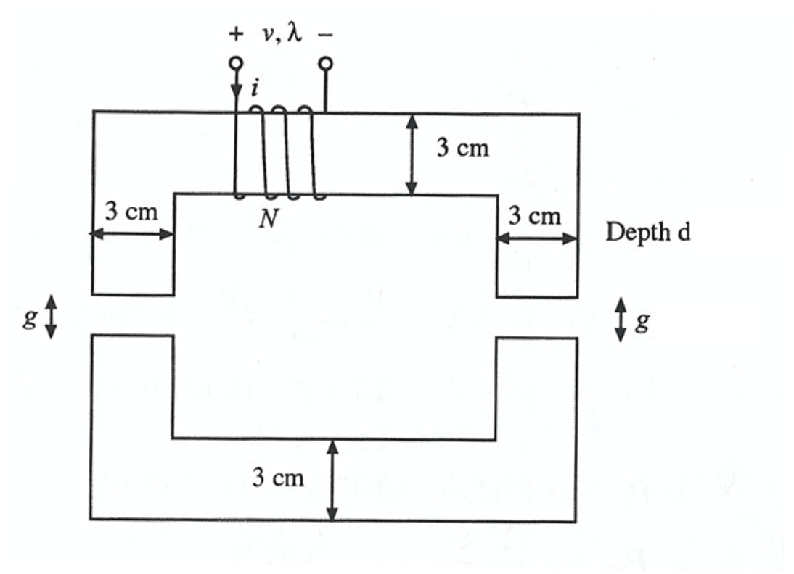
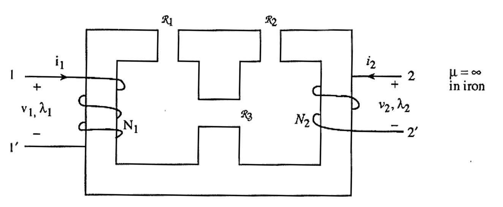
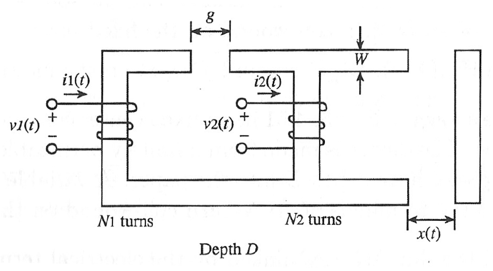
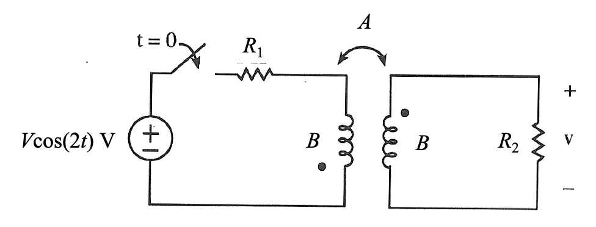

# ECE330 HW4 · 题目来源快照

网页题面转录，采集日期 2026-09-27。共5题；保留当前参数与原图，不含个人答案，不代表提交。原网站无独立作业 PDF，本文件为网页题目归档。

## HW4.1 · 3.1

[当前题目版本](https://us.prairielearn.com/pl/course_instance/226894/instance_question/733998187/?variant_id=174848424)

A coil is wrapped around an iron core as given in the figure below.

The coil has $N=217$ turns, the airgap is $g=0.19$ cm, and the depth into the page is $d=2.4$ cm. The mean path length through the entire iron core (both top and bottom pieces together) is 40 cm and the relative permeability of the iron is $\mu_r=3000$.

What are the reluctances of the core and **one of the two** air gaps? Include the effect of fringing in the air gaps.

$\mathcal R_c$ [MA turns/Wb] = ______

$\mathcal R_g$ [MA turns/Wb] = ______

What is the flux linkage when the current $i=7.4$ A?.

$\lambda$ [Wb turns] = ______

What is the inductance of the coil when the current $i=7.4$ A?

$L$ [mH] = ______

原始题图（点击展开）

## HW4.2 · 3.2

[当前题目版本](https://us.prairielearn.com/pl/course_instance/226894/instance_question/733998190/?variant_id=174848445)

The reluctances for the figure above are given as $\mathcal R_1=2\times10^6$ AT/Wb, $\mathcal R_2=1.6\times10^6$ AT/Wb, and $\mathcal R_3=1.4\times10^6$ AT/Wb. $N_1=84$ turns and $N_2=130$ turns

Keep $i_1$ and $i_2$ as variables. What are the inductances of the two coils?

$L_1$ [mH] = ______

$L_2$ [mH] = ______

What are the flux linkages in the two coils when $i_1=4.3$ A and $i_2=1.8$ A ?

$\lambda_1$ [Wb turns] = ______

$\lambda_2$ [Wb turns] = ______

原始题图（点击展开）

## HW4.3 · 4.3

[当前题目版本](https://us.prairielearn.com/pl/course_instance/226894/instance_question/733998188/?variant_id=174848464)

The infinitely permeabile iron core with $W=4.5$ cm and $D=4.8$ cm given above has 2 coils wrapped around it with $N_1=245$ turns and $N_2=246$ turns. The airgap $g=0.48$ cm is fixed.

What are the flux linkages $\lambda_1$ and $\lambda_2$ in the two coils when $i_1=10$ A, $i_2=9$ A, and $x=0.34$ cm?. (Neglect the effects of fringing.)

$\lambda_1$ [Wb turns] = ______

$\lambda_2$ [Wb turns] = ______

原始题图（点击展开）

## HW4.4 · 3.14

[当前题目版本](https://us.prairielearn.com/pl/course_instance/226894/instance_question/733998186/?variant_id=174848475)

Two coils are coupled together as shown with $A=0.45$ H, $B=1.7$ H, $R_1=2\ \Omega$ and $R_2=4\ \Omega$. The voltage source has a magnitude of $V=\sqrt{2}(130)$ V. What is the voltage $\bar V_2$ across resistor $R_2$?

$V_2$ [V] = ______

$\theta_{v2}$ [$^\circ$] = ______

原始题图（点击展开）

## HW4.5 · 3.17

[当前题目版本](https://us.prairielearn.com/pl/course_instance/226894/instance_question/733998189/?variant_id=174848482)

Two identical but mutually coupled coils are connected in two different ways, and the inductances in each case are measured.

When connected in series with the undotted terminal of one connected to the dotted terminal of the other coil, the equivalent inductance is $L_{eq}=0.099$ H.

When connected in series with the undotted terminal of one connected to the undotted terminal of the other coil, the equivalent inductance is $L_{eq}=0.027$ H.

What is the self inductance $L$, mutual inductance $M$, and coefficient of coupling $k$?

$L$ [mH] = ______

$M$ [mH] = ______

$k$ [--] = ______

