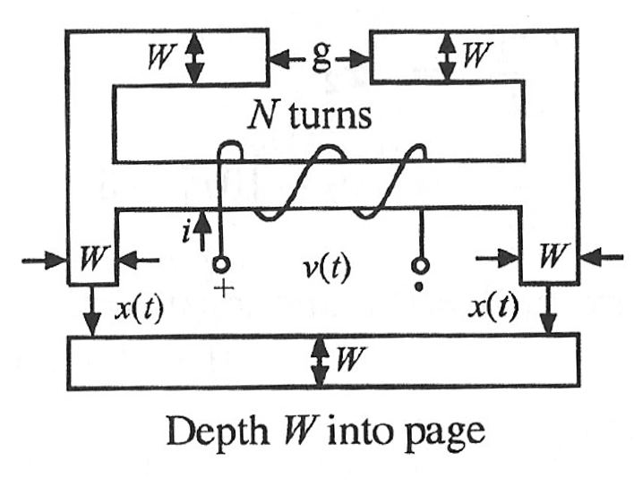
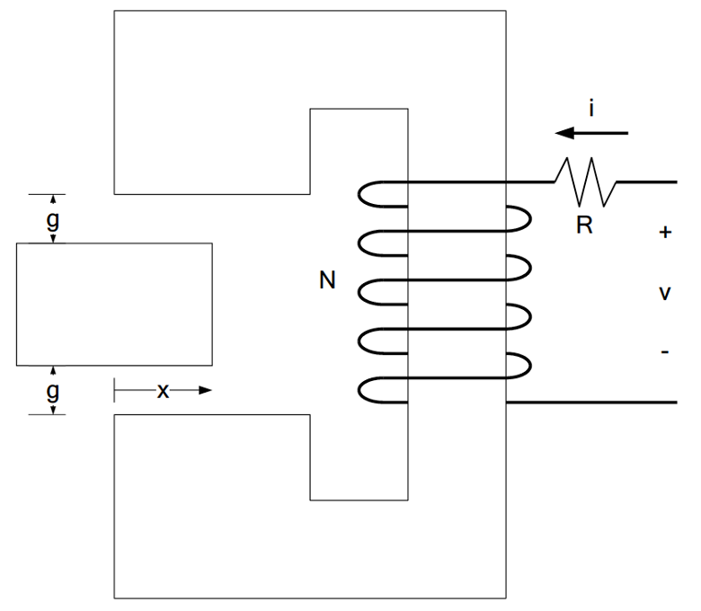
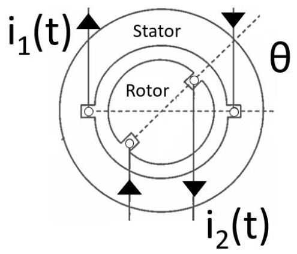

# ECE330 — Homework 5 原题快照

来源：[PrairieLearn HW5](https://us.prairielearn.com/pl/course_instance/226894/assessment/2720885/)。Fall 2026；抓取日期 2026-10-06。6 题，共 60 分。Access details 显示 Start 2026-10-05 11:00 CDT，End 为“—”，截止时间待确认。

以下保留当前网页实例的数值、英文题面与原始配图；网页题目可能随机化，以线上当前实例为准。仅题目快照，无填写或提交答案。

## HW5.1. 4.1

[线上题目](https://us.prairielearn.com/pl/course_instance/226894/instance_question/743398816/)

The infinitely permeabile iron core with $W=2$ cm given above has a coil wrapped around it with $N=123$ turns. The airgap $g=0.46$ cm is fixed while the airgap $x(t)$ cm is free to vary. The coil is driven by $i(t)$ A of current.

At time $t=0$ seconds, the variable airgap is $x(0)=0.24$ cm, and the driving current is $i(0)=4$ A. What is the numerical value of the flux linkage $\lambda$ at time $t=0$ seconds? Neglect fringing.

$\lambda$ [Wb turns] = ________

At time $t=0$ seconds, the current $i$ is <u>increasing</u> at a rate of 11 A/s, while the airgap $x$ is <u>closing</u> at a rate of $10$ m/s. What is the instantaneous voltage across the coil at time $t=0$ seconds? Neglect fringing, and use the polarities marked in the diagram.

$v$ [V] = ________

## HW5.2. 4.2

[线上题目](https://us.prairielearn.com/pl/course_instance/226894/instance_question/743398820/)

The inductance for the reluctance motor shown above with $N=215$ turns can be approximated as a sinusoidal function

$$L=L_1+L_2\cos(2\theta)$$

where the rotor angle $\theta$ is oriented as in the figure.

When $g_0=0.15$ cm, the cross-sectional area $A_{g0}=5$ cm$^2$. When $g_1=0.94$ cm, the cross-sectional area $A_{g1}=7$ cm$^2$.

What are the values of $L_1$ and $L_2$ for this motor? The reluctance of the iron core can be neglected.

$L_1$ [mH] = ________

$L_2$ [mH] = ________

## HW5.3. 4.4

[线上题目](https://us.prairielearn.com/pl/course_instance/226894/instance_question/743398818/)

The infinitely permeabile iron core with $W=1.7$ cm given above has a coil wrapped around it with $N=201$ turns. The airgap is set at $x=0.99$ cm. The coil is driven by $i=7$ A of DC current. Neglect fringing in all of your calculations.

What is the numerical value of the flux linkage $\lambda$?

$\lambda$ [Wb turns] = ________

At this very instant, the coil current $i$ is <u>decreased</u> from its original DC value at a rate of 13 A/s, while the airgap $x$ is forced to <u>open</u> at a rate of $2$ m/s. What is the instantaneous voltage across the coil? Use the polarities marked in the diagram.

$v$ [V] = ________

## HW5.4. SP 5.1

[线上题目](https://us.prairielearn.com/pl/course_instance/226894/instance_question/743398815/)

The infinitely permeabile iron core given above with a depth into the page of $D=1.7$ cm has a coil wrapped around it with $N=129$ turns and a resistance of $R=14\ \Omega$. The airgap $g=0.41$ cm is fixed.

What is the flux linkage $\lambda$ when $i=10$ A and $x=0.31$ cm? (Neglect fringing in your calculations.)

$\lambda$ [Wb turns] = ________

When $i=10$ and $x=0.31$ cm the time derivatives of the current and position are $\left.\frac{di}{dt}\right|_{i=10}=16$ A/s and $\left.\frac{dx}{dt}\right|_{x=0.31}=5$ m/s. What is the voltage across the coil for these conditions?

$v$ [V] = ________

## HW5.5. 4.8 Multi-Port

[线上题目](https://us.prairielearn.com/pl/course_instance/226894/instance_question/743398819/)

A diesel generator is modeled as an electromechanical system shown below with two electrical and one mechanical ports. The stator is modeled as "terminal 1", the rotor is modeled as "terminal 2", and the angle between the stator and the rotor is modeled as the angle variable $\theta$.

The rotor is connected to a DC current source of fixed $8$ A, and driven by a diesel generator at a fixed angular velocity of $4$ rad/s. The $\lambda-i$ relations have been modeled as the following:

$$\begin{bmatrix}\lambda_1\\\lambda_2\end{bmatrix}=\begin{bmatrix}7+3\cos(2\theta)&0.4\cos(\theta)\\0.4\cos(\theta)&66+35\cos(2\theta)\end{bmatrix}\begin{bmatrix}i_1\\i_2\end{bmatrix}$$

At time $t=0$ second, the stator is driving an electrical load with $i_1(t=0)=-9$ A, with a rate of change of $\frac{di_1}{dt}|_{t=0}=12$ A/s, and the rotor has angle $\theta(t=0)=50^\circ$. What are the instantaneous terminal voltages observed at the stator and rotor terminals?

$v_1(t=0)$ [V] = ________

$v_2(t=0)$ [V] = ________

## HW5.6. 4.8 Multi-Port-v2

[线上题目](https://us.prairielearn.com/pl/course_instance/226894/instance_question/743398817/)

A diesel generator is modeled as an electromechanical system shown below with two electrical and one mechanical ports. The stator is modeled as "terminal 1", the rotor is modeled as "terminal 2", and the angle between the stator and the rotor is modeled as the angle variable $\theta$.

The rotor is connected to a DC current source of fixed $3$ A, and driven by a diesel engine at a fixed angular velocity of $327$ rad/s. The stator is left in open circuit. The $\lambda-i$ relations have been modeled as the following:

$$\begin{bmatrix}\lambda_1\\\lambda_2\end{bmatrix}=\begin{bmatrix}8+5\cos(2\theta)&0.4\cos(\theta)\\0.4\cos(\theta)&50+25\cos(2\theta)\end{bmatrix}\begin{bmatrix}i_1\\i_2\end{bmatrix}$$

We observe a *sinusoidal* voltage waveform at the open-circuited stator. What is the magnitude and frequency of the associated AC voltage phasor? (Reminder: your answer should be stated in RMS)

$|\overline{V}_1|$ [V] = ________

$f$ [Hz] = ________
