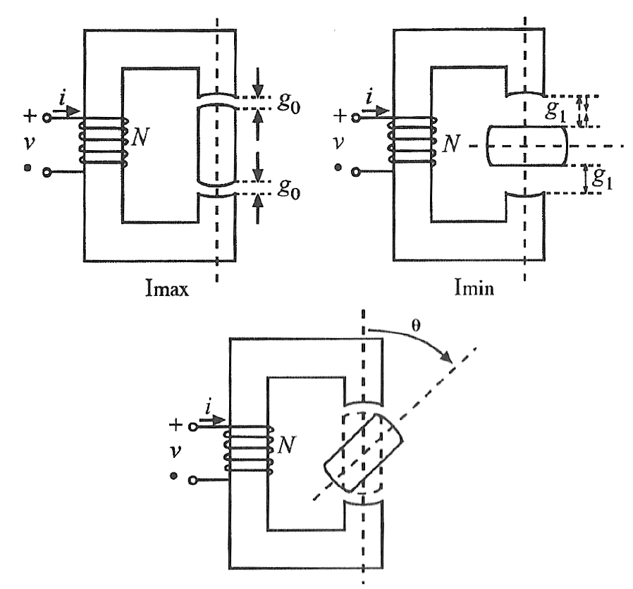
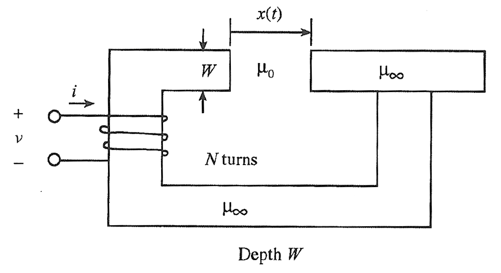

# ECE330 — Homework 6 原题快照

来源：[PrairieLearn HW6](https://us.prairielearn.com/pl/course_instance/226894/assessment/2720886/)。Fall 2026；2026-10-17在登录后的页面逐题读取，5题，共50分。Start 2026-10-08 11:00 CDT，End为“—”，未列截止时间。网页无独立原题PDF，本文件为文字、公式与原图快照；随机参数以本快照为准。浏览题目建立了网页实例，未填写、保存或评分任何答案。

## HW6.1. 4.1.2

[线上题目](https://us.prairielearn.com/pl/course_instance/226894/instance_question/755282916/)

The infinitely permeabile iron core with $W=1$ cm given above has a coil wrapped around it with $N=187$ turns. The airgap $g=0.47$ cm is fixed.

What is the energy $W_m(\lambda,x)$ when $\lambda=0.76$ Wb turns and $x=0.22$ cm?.

$W_m$ [J] = ________

What is the force of electric origin $f^e(\lambda,x)$ for these conditions?

$f^e$ [N] = ________

## HW6.2. 4.1.2 v2

[线上题目](https://us.prairielearn.com/pl/course_instance/226894/instance_question/755282919/)

The infinitely permeabile iron core with $W=3.2$ cm given above has a coil wrapped around it with $N=147$ turns. The airgap $g=0.34$ cm is fixed.

What is the co-energy $W_m^\prime(i,x)$ when $i=4$ A and $x=0.43$ cm?.

$W_m^\prime$ [J] = ________

What is the force of electric origin $f^e(i,x)$ for these conditions?

$f^e$ [N] = ________

## HW6.3. 4.2.2

[线上题目](https://us.prairielearn.com/pl/course_instance/226894/instance_question/755282915/)

The inductance for the reluctance motor shown above with $N=244$ turns can be written as

$$L=L_1+L_2\cos(2\theta)$$

where $\theta$ is defined as in the figure.

When $g_0=0.32$ cm, the cross-sectional area $A_{g0}=3$ cm$^2$. When $g_1=0.74$ cm, the cross-sectional area $A_{g1}=6$ cm$^2$.

What is the torque of electric origin $T^e$ for this motor when $\theta=49^\circ$ and $i=5$ A?

$T^e$ [Nm] = ________

## HW6.4. 4.4.2

[线上题目](https://us.prairielearn.com/pl/course_instance/226894/instance_question/755282917/)

The infinitely permeabile iron core with $W=4.3$ cm given above has a coil wrapped around it with $N=222$ turns.

What is the energy $W_m(\lambda,x)$ when $\lambda=0.11928380690657137$ Wb turns, $x=0.96$ cm, and $i=10$ A?.

$W_m$ [J] = ________

What is the co-energy $W_m^\prime(i,x)$ for the same conditions?.

$W_m^\prime$ [J] = ________

What is the force of electric origin $f^e(i,x)$ for these conditions?

$f^e$ [N] = ________

## HW6.5. 4.10

[线上题目](https://us.prairielearn.com/pl/course_instance/226894/instance_question/755282918/)

The co-energy of a device is given as $W_m^\prime=\frac{i^4}{4x}$

What is the flux linkage $\lambda$ when $i=0.87$ A and $x=0.27$ cm?.

$\lambda$ [Wb turns] = ________

What is the force of electric origin $f^e(i,x)$ for these conditions?

$f^e$ [N] = ________

What is the energy $W_m$ for the same conditions?

$W_m$ [J] = ________

