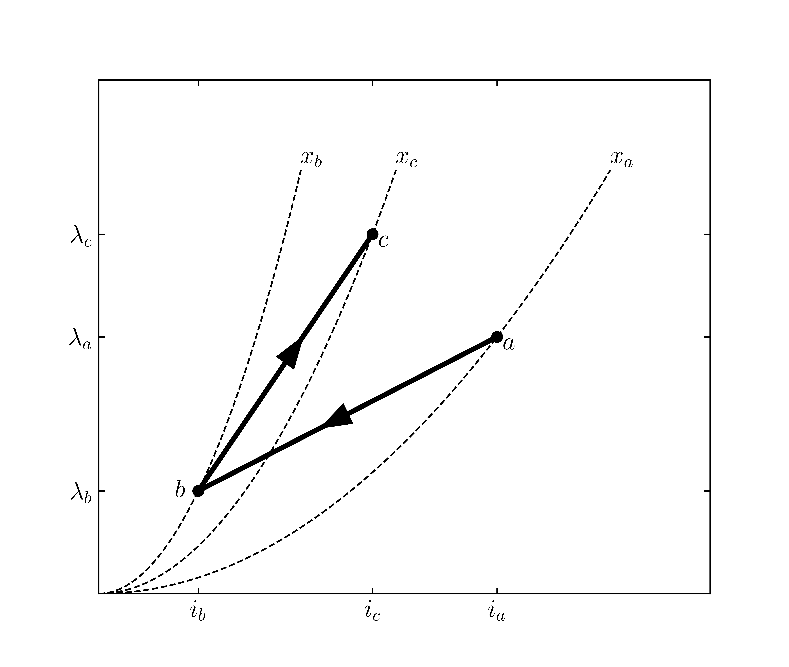

# ECE330 — Homework 7 原题快照

来源：[PrairieLearn HW7](https://us.prairielearn.com/pl/course_instance/226894/assessment/2720887/)。Fall 2026；2026-10-17在登录后的页面逐题读取，7题，共70分。Start 2026-10-15 11:00 CDT，End为“—”，未列截止时间。网页无独立原题PDF，本文件为文字、公式与原图快照；随机参数以本快照为准。浏览题目建立了网页实例，未填写、保存或评分任何答案。

## HW7.1. SP 7.1 (part 1)

[线上题目](https://us.prairielearn.com/pl/course_instance/226894/instance_question/755283495/)

The flux linkage in an energy-conservative electromechanical system is given by

$$\lambda(i,x) = \frac 12 L(x) i^2$$

where $L(x) = 2 x + 3$ H/A. Here, $x$ is the size of the gap in m, and $i$ is the current applied to the coil in A.

Compute the energy (in Joules) in the system at $i=2$ A and $x = 14$ m.

Wm [J] = ________

Compute the force of electrical origin (in Newtons) at $i=2$ A and $x = 14$ m.

f [N] = ________

## HW7.2. SP 7.1 (part 2)

[线上题目](https://us.prairielearn.com/pl/course_instance/226894/instance_question/755283499/)

The flux linkage in an energy-conservative electromechanical system is given by

$$\lambda(i,x) = \frac 12 L(x) i^2$$

where $L(x) = 2 x + 3$ H/A. Here, $x$ is the size of the gap in m, and $i$ is the current applied to the coil in A.

If the gap changes from $x = 14$ m to $x = 5$ m while maintaining a fixed current $i = 11$ A, what is the energy transfered to the magnetic field from the electrical system (EFE) for this trajectory?

EFE [J] = ________

If the current is then changed from $i = 11$ A to $i = 16$ A while maintaining a fixed gap $x = 5$ m, what is the energy transfered to the magnetic field from the mechanical system (EFM) for this trajectory?

EFM [J] = ________

## HW7.3. SP 7.2

[线上题目](https://us.prairielearn.com/pl/course_instance/226894/instance_question/755283497/)

The flux linkage for a given electromechanical system is given as $\lambda=\frac{Ai}{x-x_0}$ where $A=0.096$ Hm and $x_0=0.007$ m

$$\begin{bmatrix} & a & b & c & d & a\\ i & 0 & i_b & i_c & 0 & 0 \\ \lambda & 0 & 9 & \lambda_c & 0 &0 \\ x& 0.047& 0.047 & 0.014 & 0.014 & 0.047 \end{bmatrix}$$

The system is operated in a closed cycle $a\rightarrow b\rightarrow c\rightarrow d\rightarrow a$. $x$ is held constant along $a\rightarrow b$ and $c\rightarrow d$ and $i$ is held constant over $b\rightarrow c$ and $d\rightarrow a$.

What is $i_c$ and $\lambda_c$?

$i_c$ [A] = ________

$\lambda_c$ [Wb turns] = ________

What is energy stored in the coupling field and the force of electric origin at point $b$?

$W_{m_b}$ [J] = ________

$f^e_b$ [N] = ________

## HW7.4. 4.12

[线上题目](https://us.prairielearn.com/pl/course_instance/226894/instance_question/755283496/)

Given $W_m=3x\lambda^2$, find the energy transfered from the mechanical system to the coupling field as $x$ moves from 0.2 to 0.56 m along a constant current $i=7$ A path.

EFM [J] = ________

## HW7.5. Energy Transfer EFE

[线上题目](https://us.prairielearn.com/pl/course_instance/226894/instance_question/755283494/)

A system with $\lambda=L(x)i$ is moved between points a and b through points c and d along straight line trajectories as shown . Point d is located at $\lambda=2.8$ Wb turns and $i=1.1$ A.

What is energy stored in the coupling field at points a and b?

$W_{m_a}$ [J] = ________

$W_{m_b}$ [J] = ________

What is the energy transfered from the electrical system to the coupling field when moving from a to b?

EFE [J] = ________

## HW7.6. Energy Transfer EFM (part 1)

[线上题目](https://us.prairielearn.com/pl/course_instance/226894/instance_question/755283500/)

A system with $\lambda=\frac{A}{x-x_0}i^2$ where $A=0.005$ Wb t m/A$^2$ and $x_0=0.06$ m moves from point $a$ to point $c$ through point $b$ with the points defined as:

Point $a$: $\lambda_a=5.43$ Wb t, $i_a=7.8$ A, $x_a=0.116$ m

Point $b$: $\lambda_b=1.67$ Wb t, $i_b=1$ A, $x_b=0.063$ m

Point $c$: $\lambda_c=8.86$ Wb t, $i_c=4.8$ A, $x_c=0.073$ m

What is energy stored in the coupling field at points $a$ and $c$?

$W_{m_a}$ [J] = ________

$W_{m_c}$ [J] = ________

## HW7.7. Energy Transfer EFM (part 2)

[线上题目](https://us.prairielearn.com/pl/course_instance/226894/instance_question/755283498/)

A system with $\lambda=\frac{A}{x-x_0}i^2$ where $A=0.003$ Wb t m/A$^2$ and $x_0=0.04$ m moves from point $a$ to point $c$ through point $b$ with the points defined as:

Point $a$: $\lambda_a=4.23$ Wb t, $i_a=7.6$ A, $x_a=0.081$ m

Point $b$: $\lambda_b=2.61$ Wb t, $i_b=2.8$ A, $x_b=0.049$ m

Point $c$: $\lambda_c=7.93$ Wb t, $i_c=4.6$ A, $x_c=0.048$ m

The energy stored in the coupling field at points $a$ and $c$ are given below.

$W_m(a) = 21.413463414634144$ J

$W_m(c) = 24.333999999999996$ J

The system moves from point $a$ to point $b$ along a straight line and from point $b$ to point $c$ along a straight line.

What is the energy transfered from the mechanical system to the coupling field when moving from $a$ to $c$?

EFM [J] = ________

